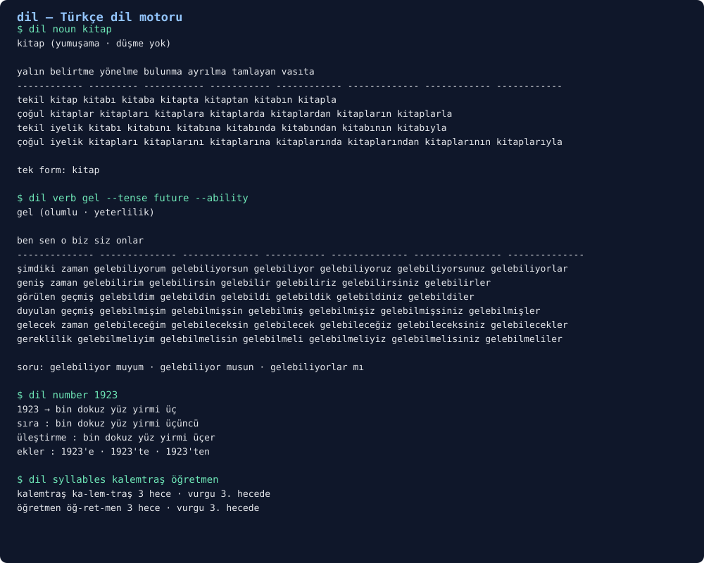

# dil

> ## ⚠️ HEAVY DEVELOPMENT — EXPECT PLENTY OF BUGS, SORRY
>
> This is an experimental engine. The rule set is still being written, some forms it
> produces are wrong, and the exception lexicon is incomplete. If a word comes out
> broken, that is expected — open an issue and we will fix it together. Do not rely on
> this alone for anything critical; check the output by eye.

> ### ⚠️ AĞIR GELİŞTİRME AŞAMASINDA — BOL BOL HATA VAR, KUSURA BAKMAYIN
>
> (Türkçe: bu araç ağır geliştirme aşamasında, bol bol hata var, kusura bakmayın.)

**A Turkish language engine** — inflection, numbers, syllables and sound changes.
Zero dependencies, fully offline, Python 3.11+.

*dil* does not guess at Turkish morphology: vowel harmony, consonant softening and
devoicing, vowel elision, the buffer letters and the personal endings are all spelled
out as rules. Give it a stem and it produces every form of the word — before you have to
write them yourself.



## What it does

| Command | Job |
| --- | --- |
| `dil noun <stem>` | 4 stem shapes × 7 cases as one table |
| `dil verb <stem>` | 6 tenses × 6 persons, negation, ability, questions |
| `dil number <value>` | spells a number, plus its ordinal, distributive and case suffix |
| `dil syllables <word>` | syllabification, hyphenation, stress guess |
| `dil sound <word>` | dissects harmony, softening and elision |
| **`dil analyze`** | **splits a word back into stem + features** (`kitaplarımızda` → `kitap + plural + 1pl possessive + locative`) |
| **`dil lint`** | **checks a text**: spelling, number suffixes, the question particle, punctuation, repeats · `--fix` repairs it |
| **`dil stats`** | **measures it**: words, sentences, syllables, diversity, reading time, Ateşman readability |
| `dil lexicon` | the exception tables (softening and vowel-dropping stems) |
| `--json` | machine-readable output for every command |

## Examples

```
$ dil noun kitap
kitap  (yumuşama · düşme yok)

                yalın      belirtme     yönelme      bulunma       ayrılma        tamlayan      vasıta
  ------------  ---------  -----------  -----------  ------------  -------------  ------------  ------------
  tekil         kitap      kitabı       kitaba       kitapta       kitaptan       kitabın       kitapla
  çoğul         kitaplar   kitapları    kitaplara    kitaplarda    kitaplardan    kitapların    kitaplarla
  tekil iyelik  kitabı     kitabını     kitabına     kitabında     kitabından     kitabının     kitabıyla
  çoğul iyelik  kitapları  kitaplarını  kitaplarına  kitaplarında   kitaplarından  kitaplarının  kitaplarıyla
```

```
$ dil verb oku
                  ben         sen          o         biz         siz            onlar
  şimdiki zaman   okuyorum    okuyorsun    okuyor    okuyoruz    okuyorsunuz    okuyorlar
  geniş zaman     okurum      okursun      okur      okuruz      okursunuz      okurlar
  görülen geçmiş  okudum      okudun       okudu     okuduk      okudunuz       okudular
  duyulan geçmiş  okumuşum    okumuşsun    okumuş    okumuşuz    okumuşsunuz    okumuşlar
  gelecek zaman   okuyacağım  okuyacaksın  okuyacak  okuyacağız  okuyacaksınız  okuyacaklar
  gereklilik      okumalıyım  okumalısın   okumalı   okumalıyız  okumalısınız   okumalılar
```

```
$ dil number 1.234.567
1.234.567 → bir milyon iki yüz otuz dört bin beş yüz altmış yedi
  sıra      : bir milyon iki yüz otuz dört bin beş yüz altmış yedinci
  üleştirme : bir milyon iki yüz otuz dört bin beş yüz altmış yedişer
  ekler     : 1.234.567'e · 1.234.567'de · 1.234.567'ten
```

```
$ dil syllables kalemtraş öğretmen pencereden
       kalemtraş  ka-lem-traş             3 hece · vurgu 3. hecede
        öğretmen  öğ-ret-men              3 hece · vurgu 3. hecede
      pencereden  pen-ce-re-den           4 hece · vurgu 4. hecede
```

## The other direction: analysis

`dil analyze` runs the generator backwards: guess a stem and a feature set, generate the word
again, and accept the analysis **only if it matches exactly**. Softening and vowel elision are
undone as well (`çocuğuna` → `çocuk`, `ağzında` → `ağız`, `gidiyorlar` → `git`).

```
$ dil analyze kitaplarımızda gidiyorlar
  kitaplarımızda
    1. kitap + çoğul + 1. çoğul iyelik + bulunma            isim   22.9

  gidiyorlar
    1. git + şimdiki zaman + 3. çoğul                       fiil   15.0
```

## Text checking

Only rules we can defend: settled misspellings, the question particle written apart, the suffix
and apostrophe on numerals, punctuation and repeated words. Rules that need the meaning of a
sentence — `de`/`da` apart or together, capitalisation — are deliberately **absent**: no guesses.

```
$ dil lint --text "herşey yanlız 1923de oldu , ve ve bitti..."
  yer   kod        açıklama
  1:1   IMLA001    yazım: «herşey» → «her şey»
  1:8   IMLA001    yazım: «yanlız» → «yalnız»
  1:15  SAYI001    ek uyumu ve kesme: «1923de» → «1923'te»
  1:26  NOKTA001   noktalamadan önce boşluk olmaz
  1:29  TEKRAR001  kelime iki kez yazılmış: «ve»
  1:40  NOKTA003   üç nokta «…» tek karakterdir

$ dil lint metin.txt --fix --write      # keeps a .bak and repairs the file
```

## Measuring and readability

Ateşman's (1997) index — `198.825 − 40.175 × (syllables/word) − 2.610 × (words/sentence)` —
labels the text: 90-100 very easy, 70-89 easy, 50-69 moderate, 30-49 hard.

```
$ dil stats makale.txt
  kelime        : 1.284 (612 tekil)
  cümle         : 74 · paragraf: 12
  ort. cümle    : 17,4 kelime · ort. kelime: 6,1 harf · 2,63 hece
  en uzun kelime: sorumluluklarımızdan (21 harf)
  çeşitlilik    : 0,48 · okuma süresi: 6,4 dk
  Ateşman       : 61,2 → orta güçlükte
```

Turkish README: [README.tr.md](README.tr.md).

## As a library

```python
from dil.nouns import decline
from dil.verbs import conjugate
from dil import numbers

decline("kitap", plural=True, possessive="1p", case="locative", softening=True)
# 'kitaplarımızda'

conjugate("bak", tense="future", person="1p")
# 'bakacağız'

conjugate("gel", tense="present", person="1s", negative=True, question=True)
# 'gelmiyor muyum'

numbers.cardinal(1923)  # 'bin dokuz yüz yirmi üç'
numbers.ordinal(4)  # 'dördüncü'
numbers.suffix(1923, "locative")  # "1923'te"
numbers.to_number("kırk iki")  # 42
```

## How the rules are encoded

- **Vowel harmony** — two-way (`a/e`) and four-way (`ı/i/u/ü`); `â î û` count as plain vowels.
- **Consonant softening** — `p ç t k` become `b c d ğ`; after `n`, `k` becomes `g`
  (`renk` → `rengi`). It only happens before a vowel-initial suffix and only on the stem
  itself (`kitap` → `kitabı`, but `kitapları`).
- **Devoicing** — `d` becomes `t` after a voiceless consonant: `kitap` + `da` = `kitapta`.
- **Vowel elision** — `ağız` → `ağzı`, `şehir` → `şehri`; never after the plural suffix.
- **Buffer letters** — `-n-` after a possessive (`arabasına`), `-y-` after a vowel-final stem
  (`arabaya`), and everywhere for irregular stems such as `su` (`suyu`, `suyun`).
- **Verb morphology** — `-yor`, `-r`, `-di`, `-miş`, `-ecek`, `-meli`, combined with negation,
  ability (`-ebil`) and the question particle, which keeps its own personal endings.

Stems that break the rules live in the exception tables in `src/dil/lexicon.py`. A word that
is not listed still inflects correctly — it just cannot know its exceptions.

## Tests

```bash
python3 -m pytest      # 317 tests
python3 -m ruff check .
```

The suite asserts real Turkish forms: `kitabımızda`, `okumuyorum`, `görmeliler`, `dörder`,
`1923'te`, `ka-lem-traş`… CI runs three operating systems × four Python versions.

## Limits

- This is a **generator**: you supply a stem, you get forms. The reverse direction — parsing a
  surface form into stem + features — is not here yet, it is first on the roadmap.
- Syllabification is a heuristic; loanword onsets may differ from the TDK guide.
- The stress guess assumes final stress, which place names and some adverbs break.

## Known bugs and gaps

Nothing here is finished — I am publishing it on purpose, to find out where it breaks:

- **No derivational morphology.** `-ki`, `-lik`, `-ci`, `-siz` are not implemented; only
  inflection works. `kitaptaki`, `güzellik`, `gözcü` cannot be produced yet.
- **The exception lexicon is small.** About 90 stems are listed. For anything else the engine
  cannot know about softening or vowel elision — pass `--softening` / `--drop-vowel` yourself.
- **No compound tenses.** `geliyormuşum`, `gelecekmişim`, `gelmiş olacağım` are missing.
- **Syllabification is a heuristic** and may differ from the TDK guide on loanword clusters.
- **Stress is a rough guess.** Place names and some adverbs behave differently.
- **Analysis is incomplete.** Derived words (`kitaptaki`, `güzellik`) cannot be parsed, and an
  unknown stem can produce several readings.
- **The checker is narrow on purpose.** `de`/`da` spacing, capitalisation and sentence-level
  errors are not checked, because they need context.

If you find a bug, open an issue with the input, what came out, and what Turkish actually says.
The fix is usually one line.

## Roadmap

- [x] `dil analyze` — stem + feature analysis of a surface form
- [x] `dil lint` — text checking: `mi`, `herşey`, `yanlız`, number suffixes, punctuation
- [x] `dil stats` — Ateşman readability, word frequency, sentence length
- [ ] derivational suffixes (`-ki`, `-lik`, `-ci`, `-siz`) and words like `kitaptaki`
- [ ] compound tenses (`geliyormuşum`, `gelmiş olacağım`)
- [ ] `de/da` and capitalisation rules for `dil lint` (they need context)

## License

MIT — see [LICENSE](LICENSE).
